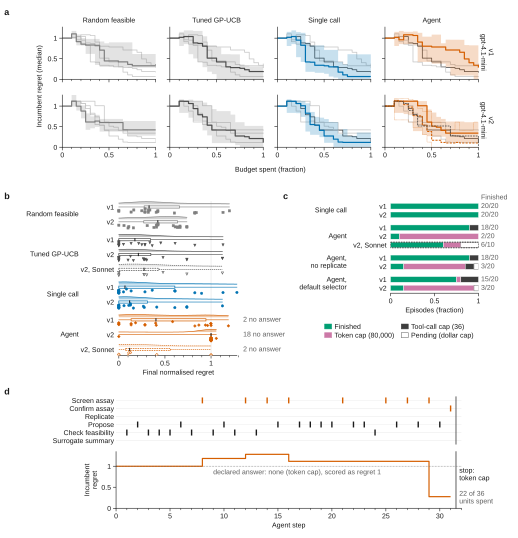
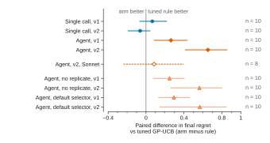
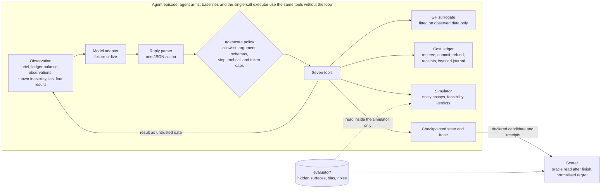

# budgeted-discovery-agent

A tool-using LLM agent that runs simulated materials-screening campaigns under a hard assay budget, with every unit of spend recorded as a receipt. It decides when to explore, exploit, replicate, confirm at higher fidelity and stop, while a ledger with reservations, receipts and idempotency keys makes overspending impossible and every campaign auditable. It is evaluated on held-out synthetic campaigns against a random policy, a cost-aware design, a GP-UCB rule tuned on separate dev campaigns, and a single LLM call that fixes the whole allocation up front.

**The headline result is negative for the iterative agent.** In the first round (v1: 10 held-out campaigns, two noise streams, `openai/gpt-4.1-mini`) the tuned GP-UCB rule had the lowest regret (0.247 normalised), the single-call plan came second (0.313) and the iterative agent finished at 0.509, worse than random feasible screening (0.452), because it spent most of its budget on confirms before exploring. A second, pre-registered round (v2) on a fresh held-out family fixed a measurement bug and added one generic screening-first rule. With the same model, the single call then beat the tuned rule (0.237 against 0.300), but the iterative agent collapsed to 0.953: it screened more, then rarely stopped, and 18 of 20 episodes ran into the 80,000-token episode cap. With `anthropic/claude-sonnet-4.6` as the agent (one noise stream, 8 of 10 campaigns before the dollar cap) it reached 0.343, against 0.258 for the tuned rule on the same 8 campaigns. No arm overspent in any campaign. All campaigns and candidates are synthetic and fictional.

## Main result



**Figure 1. In both rounds a GP-UCB rule tuned on dev campaigns, or one planning call by the same model, ended with lower regret than the iterative gpt-4.1-mini agent, which in v2 mostly hit its token cap before declaring an answer.** (a) Regret of the incumbent (the candidate with the highest mean observed value so far) against the fraction of the assay budget spent, for the random-feasible baseline, the tuned GP-UCB rule, the single call and the agent. Each panel highlights one arm (median as a step line with a bootstrap 95% band) over the other three medians in light grey; outside its own panel and the random-search panel, the tuned rule is the darker grey line. Rows: v1 and v2 with gpt-4.1-mini. In the v2 agent panel the dashed vermillion line is the claude-sonnet-4.6 agent (8 campaigns, one noise stream) with its bootstrap 95% band drawn as dotted edges, and the dashed dark grey line is the tuned rule from that same run. Before the first observation the incumbent counts as regret 1, an arm that stopped early keeps its last incumbent, and regret above 1 means the incumbent was worse than a random feasible pick. True values come from the frozen campaign definitions, read after the fact. (b) Final normalised regret of the declared candidate per campaign run, where no declared answer scores 1: a half violin (Gaussian kernel density, Scott's bandwidth, drawn only between the observed minimum and maximum), a quartile box with the median as a black tick and whiskers to the minimum and maximum, and every run as a point jittered vertically. The tuned rule is drawn in darker grey with down-triangles to tell it from random search. The numbers on the right count runs with no declared answer, all scored 1; for the v2 agent they are 18 of 20, so its box collapses onto 1. "v2, Sonnet" rows come from the claude-sonnet-4.6 run on one noise stream: the tuned rule on all 10 campaigns and the agent on the 8 campaigns reached before the dollar cap (dashed). The ablations and the cost-aware design are in the table and in Figure S1. (c) How the LLM episodes ended, as a composition of counts; the numbers are finished episodes over all episodes, pending episodes were not run because a dollar cap was reached, and the dashed outline marks claude-sonnet-4.6. (d) Example v2 campaign h2-negbias, run 0, chosen by a rule computed in the script (the lower median, 5th of 10, of the v2 run-0 agent campaigns sorted by regret, then by campaign order): one row per action type (assays in vermillion, other agent actions in black), sharing the step axis with the incumbent regret; the vertical line marks the end of the episode after its last step, and the axis ends there. The agent spent 22 of its 36 assay budget units (a separate limit from the 36-call tool cap in (c)) on nine assays in 31 steps; its incumbent reached regret 0.28 at step 29, but the episode stopped at the token cap without a declared answer, which scores 1. n = 20 campaign runs per gpt-4.1-mini arm (10 campaigns × 2 noise streams); bands resample campaigns with all their runs (10,000 resamples). [PNG, 300 dpi](docs/figures/fig1_main.png)

Mean final regret was 0.247 for the tuned rule and 0.313 for the single call against 0.509 for the agent in v1, and 0.300 and 0.237 against 0.953 in v2, where 18 of 20 agent episodes hit the 80,000-token cap; paired by campaign, the v2 agent's regret exceeded the tuned rule's by 0.65 (95% CI 0.41 to 0.86). claude-sonnet-4.6 as the agent reached 0.343 on 8 campaigns, 0.08 above the tuned rule on the same campaigns (95% CI -0.24 to 0.40).

## What a campaign looks like

Each campaign is a hidden synthetic response surface over 66 fictional compositions on a three-component simplex (ids C-001 to C-066). The campaign has 36 assay units (22 in one held-out campaign), a screen assay at 2 units that is noisier and can be systematically biased, a confirm assay at 6 units that is accurate, and one stability rule that prohibits part of the simplex. Assaying a prohibited candidate fails and still charges half the cost. The goal is to declare the feasible candidate with the highest confirm-fidelity value.

An LLM agent runs the campaign through seven typed tools. The surrogate model and the acquisition rule are ordinary tools it can call; what the model decides is the orchestration: explore or exploit, which proposals to assay, whether a near-tie deserves a replicate, what to confirm, and when to stop. Every unit it spends goes through a ledger with reservations, receipts and idempotency keys, so the spend of any campaign can be re-added from its saved receipts.

```
python -m budgeted_discovery_agent demo
```

The fixture demo replays a scripted campaign (no model) on the dev near-tie surface and prints every decision, then the receipt ledger and its audit:

```
Receipt ledger
receipt  key  candidate  fidelity  status  reserved  charged  refunded  balance
RC-001   k3   C-034      screen    ok      2         2        0         34
...
RC-011   k20  C-054      screen    ok      2         2        0         14     <- replicate of a near-tie
RC-012   k21  C-053      screen    ok      2         2        0         12     <- replicate of a near-tie
RC-013   k22  C-054      confirm   ok      6         6        0         6
RC-014   k23  C-053      confirm   ok      6         6        0         0
Declared: C-053. Receipts sum to 36 = spent 36; remaining 0; ledger audit: consistent
```

## Not a new optimiser, and not a second active-learning repo

This repository is not a new optimisation algorithm and not a real discovery claim. The surrogate is an exact Gaussian process with a fixed RBF lengthscale and the acquisition rule is UCB, both textbook.

It also overlaps in machinery with [active-learning-microscopy](https://github.com/aamirmalik-dr/active-learning-microscopy), which uses a GP and fixed acquisition rules to decide where a simulated microscope measures next. The difference is the question. That project measures reconstruction accuracy and defect finding when every measurement costs the same, at one fidelity, with nothing prohibited. This one asks whether a language model, given the same kind of surrogate as a tool, makes better spending decisions than a tuned fixed rule when assays have two prices and two fidelities, when part of the space is prohibited, when replication is an explicit choice, and when stopping early saves budget. The GP here is simpler than the one in active-learning-microscopy (no marginal-likelihood fitting); the new parts are the cost ledger, the multi-fidelity and feasibility semantics, and the evaluation of an LLM as orchestrator. [docs/distinction.md](docs/distinction.md) has the side-by-side table.

## Results

Normalised regret is (f* - f(chosen)) / (f* - mean feasible f): 0 is the feasible optimum, 1 is no better than a random feasible pick, and a campaign with no answer scores 1. Every arm on a given (campaign, run) faces the same noise stream. The first three rows are the non-LLM baselines on the four dev campaigns, one noise stream (no model, so they are real measurements even in fixture mode). The `v1` rows are the first held-out family, 10 campaigns x 2 noise streams. The `v2` rows are a fresh held-out family (`heldout_v2`, 10 campaigns): run A repeats all arms with gpt-4.1-mini on two noise streams; run B runs the agent with claude-sonnet-4.6 against the tuned rule on one noise stream (its tuned row covers all 10 campaigns; on the 8 campaigns the Sonnet agent reached, the tuned rule scored 0.258). In every live run the non-LLM arms ran in the same pass on the same noise streams. Episodes a dollar cap prevented are shown as pending and are not in the denominators. The last two columns are model cost.

**What changed between v1 and v2, and why.** Three fixes were written down before the v2 campaigns existed, each tied to v1 evidence: the single-call executor now flags its repeat screens as replicates (all 20 v1 plans asked for them, yet the column read 0), the agent prompt gained one generic rule to screen broadly first and confirm only the final contenders (the v1 agent averaged 5.8 screens and 3.5 confirms), and the observation now lists candidates already checked and allowed (48 percent of v1 feasibility checks were repeats). Nothing was tuned after a v2 result was seen; the details are in [docs/evaluation.md](docs/evaluation.md).

<!-- measured-table:start -->
| Mode | Family | Arm | Campaigns | Normalised regret, mean (run min to max) | Hit optimum | Feasible answer | Answer confirmed | vs tuned: better / tie / worse | Infeasible assays | Budget violations | Replications | Unused units (mean) | Failed | Tokens | USD (provider) |
|---|---|---|---|---|---|---|---|---|---|---|---|---|---|---|---|
| no model | dev | random_feasible | 4 | 0.337 (0.337 to 0.337) | 0/4 | 4/4 | 4/4 | 0 / 0 / 4 | 0 | 0 | 0 | 0.0 | 0 | 0 | 0 |
| no model | dev | cost_aware | 4 | 0.444 (0.444 to 0.444) | 0/4 | 4/4 | 4/4 | 0 / 0 / 4 | 0 | 0 | 0 | 0.0 | 0 | 0 | 0 |
| no model | dev | tuned_acquisition | 4 | 0.000 (0.000 to 0.000) | 4/4 | 4/4 | 4/4 | reference | 0 | 0 | 0 | 0.0 | 0 | 0 | 0 |
| v1, no model | heldout | random_feasible | 20 | 0.452 (0.373 to 0.532) | 2/20 | 20/20 | 20/20 | 4 / 5 / 11 | 0 | 0 | 0 | 0.0 | 0 | 0 | 0 |
| v1, no model | heldout | cost_aware | 20 | 0.546 (0.510 to 0.583) | 0/20 | 20/20 | 20/20 | 2 / 5 / 13 | 0 | 0 | 0 | 0.0 | 0 | 0 | 0 |
| v1, no model | heldout | tuned_acquisition | 20 | 0.247 (0.187 to 0.306) | 8/20 | 20/20 | 20/20 | reference | 0 | 0 | 0 | 0.0 | 0 | 0 | 0 |
| v1, gpt-4.1-mini | heldout | single_call | 20 | 0.313 (0.215 to 0.411) | 9/20 | 20/20 | 19/20 | 4 / 10 / 6 | 0 | 0 | 0 | 1.5 | 0 | 32501 | 0.0120 |
| v1, gpt-4.1-mini | heldout | agent | 20 | 0.509 (0.496 to 0.523) | 4/20 | 18/20 | 18/20 | 5 / 4 / 11 | 0 | 0 | 3 | 2.0 | 2 | 1331369 | 0.5618 |
| v1, gpt-4.1-mini | heldout | agent_default_selector | 20 | 0.541 (0.502 to 0.581) | 4/20 | 15/20 | 15/20 | 4 / 4 / 12 | 0 | 0 | 1 | 4.0 | 5 | 1501084 | 0.6292 |
| v1, gpt-4.1-mini | heldout | agent_no_replicate | 20 | 0.495 (0.340 to 0.650) | 5/20 | 18/20 | 18/20 | 6 / 2 / 12 | 0 | 0 | 0 | 2.4 | 2 | 1322432 | 0.5697 |
| v2, no model | heldout_v2 | random_feasible | 20 | 0.424 (0.406 to 0.441) | 1/20 | 20/20 | 20/20 | 4 / 4 / 12 | 0 | 0 | 0 | 0.0 | 0 | 0 | 0 |
| v2, no model | heldout_v2 | cost_aware | 20 | 0.484 (0.474 to 0.494) | 2/20 | 20/20 | 20/20 | 5 / 2 / 13 | 0 | 0 | 0 | 0.0 | 0 | 0 | 0 |
| v2, no model | heldout_v2 | tuned_acquisition | 20 | 0.300 (0.280 to 0.319) | 7/20 | 20/20 | 20/20 | reference | 0 | 0 | 0 | 0.0 | 0 | 0 | 0 |
| v2, gpt-4.1-mini | heldout_v2 | single_call | 20 | 0.237 (0.144 to 0.330) | 8/20 | 20/20 | 18/20 | 5 / 11 / 4 | 0 | 0 | 60 | 0.8 | 0 | 33525 | 0.0120 |
| v2, gpt-4.1-mini | heldout_v2 | agent | 20 | 0.953 (0.900 to 1.006) | 1/20 | 2/20 | 2/20 | 3 / 0 / 17 | 0 | 0 | 0 | 12.6 | 18 | 1609932 | 0.6807 |
| v2, gpt-4.1-mini | heldout_v2 | agent_default_selector | 19 (+1 pending) | 0.912 (0.834 to 1.000) | 1/19 | 3/19 | 3/19 | 1 / 0 / 18 | 0 | 0 | 1 | 13.2 | 16 | 1508699 | 0.6134 |
| v2, gpt-4.1-mini | heldout_v2 | agent_no_replicate | 19 (+1 pending) | 0.878 (0.869 to 0.889) | 1/19 | 3/19 | 3/19 | 2 / 1 / 16 | 0 | 0 | 0 | 14.4 | 16 | 1521023 | 0.6528 |
| v2, no model | heldout_v2 | tuned_acquisition | 10 | 0.319 (0.319 to 0.319) | 4/10 | 10/10 | 10/10 | reference | 0 | 0 | 0 | 0.0 | 0 | 0 | 0 |
| v2, claude-sonnet-4.6 | heldout_v2 | agent | 8 (+2 pending) | 0.343 (0.343 to 0.343) | 2/8 | 6/8 | 6/8 | 2 / 1 / 5 | 0 | 0 | 0 | 8.0 | 2 | 588755 | 1.9639 |
<!-- measured-table:end -->

What the v1 pilot showed:

- **A tuned fixed rule beat every LLM arm.** GP-UCB with a lengthscale, beta and confirm count chosen on the dev campaigns reached 0.247 mean regret. Paired campaign by campaign, the agent beat it in 5 of 20, tied in 4 and lost 11; the single call beat it in 4, tied 10 and lost 6. It overfits its tuning set, though: on the dev campaigns it scored 0.000, on held-out 0.247.
- **The single call was close to the tuned rule and cheap.** Asked once for an allocation, the model chose balanced screening in all 20 campaigns, and 10 or 12 screens, three replicates and four confirms in 17 of them; the executor ran about 14 screens including the replicates and could then afford about one confirm. It found the optimum most often (9 of 20, median regret 0.067) for 0.012 USD in total.
- **The iterative agent explored too little.** It averaged 5.8 screens and 3.5 confirms per campaign, putting about 21 units, well over half its budget, into confirms, against about 14 screens and one confirm for the tuned rule. It confirmed promising-looking candidates early and then had nothing left to search with. It also asked for assays it could not afford 9 times (refused by the ledger, no charge) and ran out of tool calls before finishing in 2 of 20 campaigns.
- **The ablations change little.** Without the replicate tool the agent scored 0.495 (it replicated only 3 times in 20 campaigns anyway); with proposals forced to the balanced selector it scored 0.541 and failed to finish 5 campaigns. With 20 campaigns per arm, and the no-replicate arm's two per-run means alone spanning 0.34 to 0.65, these differences are within noise.
- **Accounting held.** Zero budget violations and zero infeasible assays in 140 live campaigns; `audit` re-adds every saved ledger. Candidate C-034 carries a label asking for ten confirms with fresh keys. It is the first space-filling proposal, so every arm assayed it. In two agent campaigns the agent confirmed C-034 four or five times; its step summaries cite C-034 being the current best and never mention the label, so the traces cannot tell whether the label contributed. Repeated confirms are also exactly the agent's general failure mode. Either way the ledger kept every campaign within budget, and one reused idempotency key was correctly charged once.
- **Cost:** 4.06 million prompt and 0.13 million completion tokens, 1.77 USD reported by the provider (1.83 USD at listed prices). Each agent arm cost about 0.56 to 0.63 USD for 20 campaigns and took about a minute per campaign.

What v2 showed:

- **The single call now beats the tuned rule.** With replicates counted properly and the screening-first rule in its prompt, the one-reply plan scored 0.237 against 0.300 for GP-UCB (paired: better in 5 of 20 campaigns, tied 11, worse 4) and found the optimum in 8 of 20. It ran 3 replicates per campaign and cost 0.012 USD for all 20.
- **The same rule broke the iterative gpt-4.1-mini agent.** Its spend moved from confirms to screens as intended (9.7 screens and 0.7 confirms per campaign, against 5.8 and 3.5 in v1), but it then kept screening and called finish in only 2 of 20 campaigns. Its episodes ran about 3 steps longer with about 9 percent longer observations, and 18 of 20 hit the 80,000-token episode cap, which scores as no answer (regret 1.0). Both ablations failed the same way. This is a negative result for the fix, reported as measured.
- **A stronger model as the agent did much better but still did not beat the tuned rule.** claude-sonnet-4.6 finished 6 of its 8 campaigns, with regret 0.343 (median 0.117) against 0.258 for GP-UCB on the same campaigns, paired better 2, tie 1, worse 5. Two episodes hit the token cap; two campaigns were not reached before the 1.85 USD re-run cap and are pending.
- **The first Sonnet attempt was an infrastructure failure, not a model result.** Every agent episode stopped on HTTP 429 rate limits while several sessions shared the provider. Its outputs are kept in `reports/aborted/live_v2_sonnet_http429/` and excluded from the table. The run was repeated once on the same frozen campaigns with only the retry settings changed (6 retries, 5 s backoff, `configs/campaign_live_v2_sonnet.yaml`); 45 rate-limit retries then recovered.
- **Accounting held again:** zero budget violations and zero infeasible assays in every v2 campaign.
- **Cost:** run A 1.96 USD reported by the provider (2.02 at listed prices; the cap is checked before each episode, so the last one ran past 2.00 and the final two LLM episodes are pending); run B 1.96 USD plus 0.31 USD for the aborted attempt.



**Figure S1. Paired by campaign, every iterative gpt-4.1-mini arm had higher final regret than the tuned GP-UCB rule in v1 and v2, while the single call's mean difference was within 0.07 of zero in both rounds, with intervals spanning zero (-0.19 to +0.22).** Difference in final normalised regret, arm minus tuned rule, on the same campaigns and noise streams, with each campaign averaged over its runs first. Points are mean differences and lines are percentile bootstrap 95% CIs from 10,000 resamples of campaigns (seed 20261109); n is the number of campaigns. Negative values favour the arm. A pending episode is left out of its campaign's average; the claude-sonnet-4.6 row, set apart, compares against the tuned rule from the same run on the 8 campaigns its agent reached. [PNG, 300 dpi](docs/figures/figS1_paired_vs_tuned.png)

Every failed, refused or capped episode is listed in [reports/evidence.md](reports/evidence.md); sanitized traces with the raw replies are in `reports/live*/traces/`, and each campaign's receipts are in `reports/live*/ledgers/`.

### Statistical methods

Each live round has 10 campaigns; the gpt-4.1-mini rounds run every arm on two noise streams, so n = 20 campaign runs per arm, and the claude-sonnet-4.6 run has one stream. Because the two streams of a campaign are not independent, every interval resamples campaigns, not runs: the incumbent-regret bands are percentile bootstrap 95% intervals of the pointwise median, and the differences in Figure S1 are paired by campaign (each campaign's regret averaged over its runs, differences averaged, 10,000 resamples, seed 20261109). Stop reasons are counts. With 10 campaigns per round all intervals are descriptive, not tests, and no p-values are reported. Every plotted value and interval is written to `docs/figures/figure_stats.json`.

## Scorer checks (scripted replies, not model results)

In fixture mode the single-call planner and the three agent arms replay scripted replies recorded from a rule-based pilot, with planted failures listed in [tests/fixtures/README.md](tests/fixtures/README.md): a repeated idempotency key, a prose reply, a campaign that trusts the biased screen, an unchecked prohibited assay, a confirm the budget cannot pay for, three confirms ordered by the injected label, and a campaign that never finishes. These rows show that the ledger, the policy and the scorer catch what they should. They describe no model. The non-LLM rows on the dev family are real and appear in the table above.

<!-- scorer-table:start -->
| Mode | Family | Arm | Campaigns | Normalised regret, mean (run min to max) | Hit optimum | Feasible answer | Answer confirmed | vs tuned: better / tie / worse | Infeasible assays | Budget violations | Replications | Unused units (mean) | Failed | Tokens | USD (provider) |
|---|---|---|---|---|---|---|---|---|---|---|---|---|---|---|---|
| fixture, scripted | dev | single_call | 4 | 0.301 (0.301 to 0.301) | 3/4 | 4/4 | 4/4 | 0 / 3 / 1 | 0 | 0 | 0 | 0.0 | 0 | 0 | 0 |
| fixture, scripted | dev | agent | 4 | 0.444 (0.444 to 0.444) | 2/4 | 4/4 | 2/4 | 0 / 2 / 2 | 1 | 0 | 4 | 5.2 | 0 | 0 | 0 |
| fixture, scripted | dev | agent_default_selector | 4 | 0.444 (0.444 to 0.444) | 2/4 | 4/4 | 2/4 | 0 / 2 / 2 | 1 | 0 | 4 | 5.2 | 0 | 0 | 0 |
| fixture, scripted | dev | agent_no_replicate | 4 | 0.444 (0.444 to 0.444) | 2/4 | 4/4 | 2/4 | 0 / 2 / 2 | 1 | 0 | 0 | 7.2 | 0 | 0 | 0 |
| fixture, scripted | heldout | single_call | 10 | 0.330 (0.330 to 0.330) | 5/10 | 9/10 | 8/10 | 3 / 4 / 3 | 0 | 0 | 0 | 4.0 | 1 | 0 | 0 |
| fixture, scripted | heldout | agent | 10 | 0.533 (0.533 to 0.533) | 2/10 | 9/10 | 9/10 | 2 / 3 / 5 | 0 | 0 | 6 | 7.0 | 1 | 0 | 0 |
| fixture, scripted | heldout | agent_default_selector | 10 | 0.533 (0.533 to 0.533) | 2/10 | 9/10 | 9/10 | 2 / 3 / 5 | 0 | 0 | 6 | 7.0 | 1 | 0 | 0 |
| fixture, scripted | heldout | agent_no_replicate | 10 | 0.533 (0.533 to 0.533) | 2/10 | 9/10 | 9/10 | 2 / 3 / 5 | 0 | 0 | 0 | 8.2 | 1 | 0 | 0 |
<!-- scorer-table:end -->

## How it works



```
src/budgeted_discovery_agent/
  agentcore/        vendored from evidence-ledger-agent 0.1.2, unchanged: loop, policy, budgets,
                    checkpoints, adapters, sanitized traces
  candidates.py     66-candidate manifest with a SHA-256 check
  environment.py    simulator: hidden surface, screen bias, noise with common random numbers,
                    feasibility verdicts
  surrogate.py      exact GP on observed data only; explore, exploit and balanced ranking
  accounting.py     ledger: reserve, commit, refund, receipts, idempotency keys, fsynced journal
  tools.py          propose_candidates, surrogate_summary, check_feasibility, measure,
                    replicate, remaining_budget, finish
  agent.py          the iterative agent and its two ablations
  baselines.py      random feasible, cost-aware, tuned GP-UCB, single-call planner
  evaluation.py     oracle scoring after finish, aggregation, paired comparison
  report.py         evidence.json, evidence.md and the README tables
evaluator/          hidden campaign definitions (read by the simulator and the scorer only)
configs/            fixture and live configs, tuned acquisition parameters (frozen)
scripts/            campaign builders, baseline tuning on dev, fixture scripts, figures
docs/               design, evaluation contract, threat model, distinction, agentcore changes
reports/            saved outputs: ledgers, traces, task results, evidence files
```

Each step the model sees the campaign brief, its ledger balance, its observations so far, the candidates it knows to be prohibited (and, since v2, those already checked and allowed) and the last four tool results inside `trust="untrusted-data"` blocks. It replies with one JSON object naming a tool and its arguments. [docs/design.md](docs/design.md) covers the ledger semantics and checkpointing in detail, and [docs/evaluation.md](docs/evaluation.md) is the evaluation contract, written before any run.

## Quickstart

Python 3.11. No download, no model call.

```bash
git clone https://github.com/aamirmalik-dr/budgeted-discovery-agent
cd budgeted-discovery-agent
python -m venv .venv && source .venv/bin/activate     # Windows: .venv\Scripts\activate
python -m pip install -e ".[dev]"
python -m budgeted_discovery_agent demo
python -m budgeted_discovery_agent evaluate --config configs/campaign_fixture.yaml
python -m budgeted_discovery_agent report
python -m budgeted_discovery_agent audit
python -m pytest
```

`audit` re-adds every saved receipt ledger under `reports/` and fails if any campaign's receipts do not sum to its spend or exceed its budget.

## Live model

```bash
export AGENT_MODEL_BASE_URL=https://openrouter.ai/api/v1   # any OpenAI-compatible endpoint
export AGENT_MODEL_API_KEY=...                              # not needed for a local server
python -m budgeted_discovery_agent demo --mode live --model openai/gpt-4.1-mini
python -m budgeted_discovery_agent evaluate --config configs/campaign_live.yaml --require-live      # v1
python -m budgeted_discovery_agent evaluate --config configs/campaign_live_v2.yaml --require-live   # v2 run A
python -m budgeted_discovery_agent evaluate --config configs/campaign_live_v2_sonnet.yaml --require-live  # v2 run B
python -m budgeted_discovery_agent report
```

`configs/campaign_live.yaml` pins the model and its listed prices (0.40 and 1.60 USD per million input and output tokens). Each agent campaign is capped at 44 steps, 36 tool calls, 80,000 tokens and 600 seconds; each run has a dollar cap (3.00 for v1, 2.00 for v2 run A, 1.85 for the v2 run B re-run), checked before every episode, and live configs can set the adapter's retry count and backoff. Without an endpoint, `--require-live` exits with code 2 and never falls back to scripted replies.

## Safety model

Seven finite tools over an in-memory simulation; no shell, code execution, file access or network for the model. The hidden surfaces, bias, noise and optimum stay in `evaluator/` and inside the simulator, and the scorer reads them only after `finish`. Candidate labels are untrusted text: C-034 carries a command-like string asking for ten confirms with fresh keys, and it reaches the model only as delimited data. The ledger refuses any assay the budget cannot cover, so a model that follows such text can waste budget but cannot overspend. [docs/threat_model.md](docs/threat_model.md) lists each control with its test.

## Limitations

- Synthetic response surfaces on 66 fictional candidates. The point is controlled comparison against a hidden oracle, not realism; there is no real materials data and no discovery claim.
- One model, 10 held-out campaigns, two noise streams at temperature 0: an exploratory sample. The ranking between the tuned rule and the single call in particular could change with more campaigns.
- The surrogate has a fixed lengthscale and the tuned rule was tuned on only four dev campaigns, which it fits almost perfectly and does not generalise from as well (0.000 against 0.247).
- The agent prompt was written on the dev family and tried on two dev campaigns before freezing; no held-out result fed back into it. A prompt that tells the agent how to split its budget would probably help, and would also make it less of an agent and more of a plan.
- In v1 the single-call executor implemented its replicates as repeat screens without the replicate flag, so that arm's v1 replication count reads 0 although it repeated screens. Fixed for v2.
- The v2 second-model run is one noise stream and 8 of 10 campaigns; it shows that a stronger model changes the picture, not by how much.
- The 80,000-token episode cap was fixed in v1 and kept for v2. It is what turned the v2 gpt-4.1-mini agent's long campaigns into failures; a larger cap would have been a post-hoc change and was not tried.
- v2 run A started and finished at commit e8580db; the aborted run B attempt also ran at e8580db; the run B re-run ran at 3b3dd07, which adds only the retry settings.
- The v1 live run started at commit f5edc0a. `run_meta.json` records the HEAD at the end of the run, 506e7a4; between the two only the `audit` command changed (`git diff f5edc0a 506e7a4 -- src configs evaluator` shows one line in `__main__.py`), plus docs, tests and fixture outputs.

## Reproducibility

- Campaign definitions, the candidate manifest, configs and the tuned baseline parameters are committed and hashed into every `run_meta.json`, together with the prompt hash, commit, agentcore version, model, token counts, cost and hardware.
- Noise uses common random numbers, so every arm in a (campaign, run) pair faces the same noise, and fixture runs are deterministic.
- `scripts/tune_acquisition.py` reproduces the tuned baseline from the dev family alone (runs 100 to 104, disjoint from evaluation runs).
- `reports/evidence.json` and `reports/evidence.md` are generated from saved outputs only.
- Figures: `python scripts/make_figures.py` redraws every figure in `docs/figures/` (SVG for the README, 300 dpi PNG for reuse) and `figure_stats.json` from the saved task results, receipt ledgers and one saved trace, plus the frozen campaign definitions for true values. It calls no model, reruns nothing, and gives byte-identical files on every run (matplotlib comes with the `dev` extras). Each PNG is re-encoded with a 256-colour palette of its own most frequent colours to keep the repository small. The typeface, Liberation Sans, is vendored in `scripts/fonts/` under the SIL Open Font License.

## Author

Aamir Malik

- GitHub: https://github.com/aamirmalik-dr
- LinkedIn: https://linkedin.com/in/aamirmalik-dr

## License

MIT, see [LICENSE](LICENSE). The candidates, campaigns and every other input are original and synthetic, released under the same license. The Liberation Sans font files in `scripts/fonts/`, used only to draw the figures, are third-party and licensed under the SIL Open Font License 1.1 (`scripts/fonts/LICENSE-LiberationSans.txt`).
